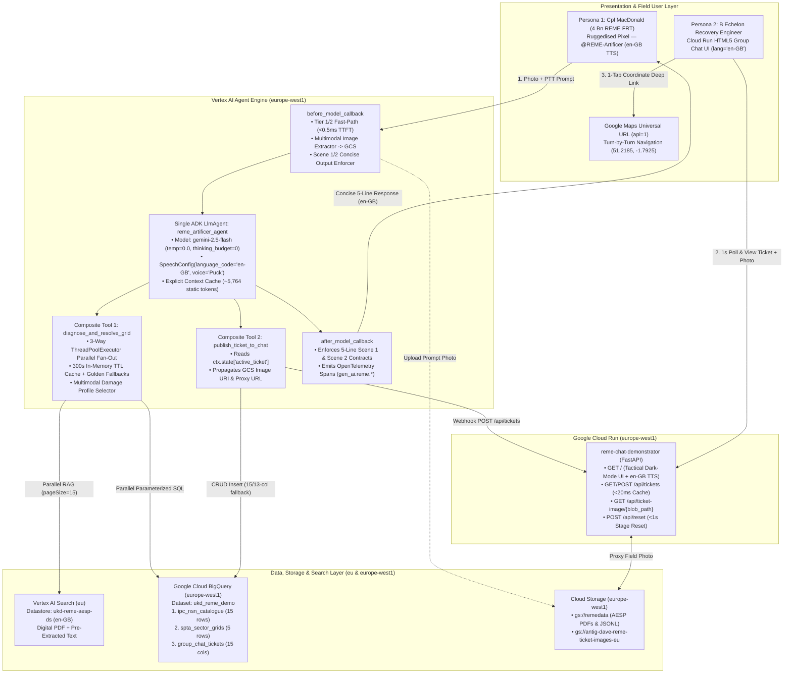
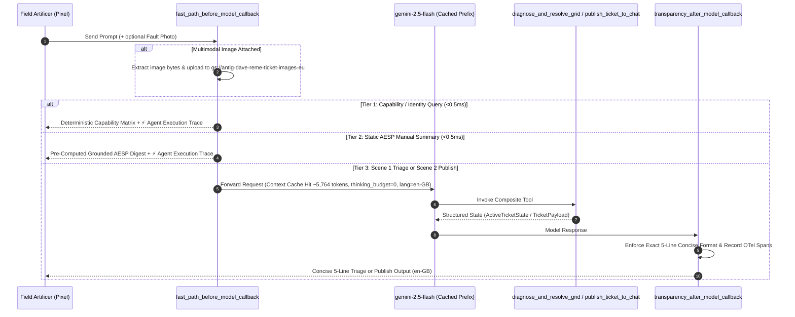

# Solutions Design Document: Pixel Roots — Demo 1 ("Snap, Diagnose, Pin & Demand")

## Document Control & Metadata

| Field | Specification Value |
| :--- | :--- |
| **Document ID** | `SDD-DEMO1-ADK2-006` (As-Built Solutions Design incorporating Fixes 01–06) |
| **Programme & Use Case** | **Pixel Roots — Demo 1: The Tactical Sustainment JNCO ("Snap, Diagnose, Pin & Demand")** |
| **Primary Sources of Truth** | [AGENTS.md](file:///usr/local/google/home/edwardsda/Documents/Demo%201%20-%20Reme/AGENTS.md), [Demo 1 - SA.md](file:///usr/local/google/home/edwardsda/Documents/Demo%201%20-%20Reme/docs/architecture/Demo%201%20-%20SA.md), [implementation-plan.md](file:///usr/local/google/home/edwardsda/Documents/Demo%201%20-%20Reme/docs/architecture/implementation-plan.md), [issue-01-fix.md](file:///usr/local/google/home/edwardsda/Documents/Demo%201%20-%20Reme/docs/architecture/issue-01-fix.md), [issue-02-fix.md](file:///usr/local/google/home/edwardsda/Documents/Demo%201%20-%20Reme/docs/architecture/issue-02-fix.md), [issue-03-fix.md](file:///usr/local/google/home/edwardsda/Documents/Demo%201%20-%20Reme/docs/architecture/issue-03-fix.md), [issue-04-fix.md](file:///usr/local/google/home/edwardsda/Documents/Demo%201%20-%20Reme/docs/architecture/issue-04-fix.md), [issue-05-fix.md](file:///usr/local/google/home/edwardsda/Documents/Demo%201%20-%20Reme/docs/architecture/issue-05-fix.md), [issue-06-fix.md](file:///usr/local/google/home/edwardsda/Documents/Demo%201%20-%20Reme/docs/architecture/issue-06-fix.md) |
| **Target GCP Project** | `antig-dave` (`284046449012`) |
| **Regional Compute & Storage** | **`europe-west1` (Belgium)** — Vertex AI (`gemini-2.5-flash`), Vertex AI Agent Engine (`6397856951400660992`), Agent Registry, Cloud Run (`reme-chat-demonstrator`), BigQuery (`ukd_reme_demo`), Cloud Storage (`gs://antig-dave-reme-ticket-images-eu`) |
| **Multi-Region Search & Gemini App** | **`eu` (European Union)** — Discovery Engine Datastore (`ukd-reme-aesp-ds`, `languageCode: "en-GB"`) & Gemini Enterprise App (`pixel-mobile-demos_1793177711952`) |
| **Agent Framework & SDK** | **Google Agent Development Kit (`google-adk`)** + **`google-genai`** SDK (`temperature=0.0`, `thinking_budget=0`, `max_output_tokens=768`, `SpeechConfig(language_code="en-GB")`) |
| **Source Code Repository** | https://github.com/edwardsda-prog/reme-agent |

---

## 1. Executive Summary & Operational Narrative

Forward Repair Teams (FRTs) in **4 Battalion REME** deployed on **Salisbury Plain Training Area (SPTA)** require an accredited **OFFICIAL** workflow on a ruggedised **Google Pixel (Titan M2, COBO Work Profile)** to replace unaccredited shadow-IT messaging apps.

In this 3-scene tactical sustainment demonstrator:
1. **Scene 1 (Multimodal Field Capture & Concise Diagnosis):** **Cpl "Mac" MacDonald** captures a photograph of a damaged vehicle subsystem (e.g., an FV432 Rolls-Royce K60 engine oil pressure relief valve or a Jackal 2 hydraulic assembly) and speaks a Push-to-Talk (PTT) prompt with his tactical sector grid. The `@REME-Artificer` agent evaluates whether the fault is field-fixable by the soldier or requires replacement component(s), grounds its diagnosis in **AESP 2350-T-250-523** / **AESP 2320-J-100-522**, resolves the NATO Stock Number (NSN) and WGS84 grid coordinates, persists any attached field photograph to Cloud Storage (`gs://antig-dave-reme-ticket-images-eu`), and returns a concise 5-line tactical output card in **British English (`en-GB`)**.
2. **Scene 2 (Concise Recovery Ticket Broadcast):** Cpl MacDonald taps or says **"Publish to Group Chat"**. The agent reads the blackboard session state (`ctx.state["active_ticket"]`) without re-prompting, writes the 15-column recovery ticket (including the persisted field photograph URL/URI) to BigQuery (`ukd_reme_demo.group_chat_tickets`), dispatches it to the Cloud Run Group Chat webhook (`POST /api/tickets`) in `< 20 ms`, and outputs a concise 5-line dispatch confirmation.
3. **Scene 3 (B Echelon Group Chat, British English Audio Readout & Google Maps Handoff):** A recovery engineer opens the **4 Bn REME — Sustainment Group Chat** web application on Cloud Run (`<html lang="en-GB">`), inspects the live ticket card together with the embedded field casualty photograph, optionally taps **🔊 READ ALOUD (`en-GB`)** for a hands-free British English audio brief, and taps the coordinate button to launch **Google Maps** turn-by-turn navigation (`api=1`) directly to the casualty vehicle.

> [!IMPORTANT]
> **Strict Data Residency & Quality Bounds:** All compute, model inference, BigQuery tables, Cloud Run services, and ticket image buckets are pinned to **`europe-west1` (Belgium)**, while Discovery Engine and Gemini Enterprise resources reside in the **`eu`** multi-region. All schemas in [schemas.py](file:///usr/local/google/home/edwardsda/Documents/Demo%201%20-%20Reme/app/schemas.py) enforce `ConfigDict(extra="forbid")` with zero `Any` usage.

---

## 2. End-to-End System Architecture

### 2.1 High-Level Topology Diagram



---

## 3. Architectural Evolution & Engineering Remediations (Issues 01–05)

Following the initial baseline implementation defined in [Demo 1 - SA.md](file:///usr/local/google/home/edwardsda/Documents/Demo%201%20-%20Reme/docs/architecture/Demo%201%20-%20SA.md) and [implementation-plan.md](file:///usr/local/google/home/edwardsda/Documents/Demo%201%20-%20Reme/docs/architecture/implementation-plan.md), five targeted engineering remediations were designed, verified, and integrated.

### 3.1 Summary Matrix of Issues 01–05

| Issue ID | Observed Symptom | Root Cause | Architectural Solution Implemented | Key Modified Files |
| :--- | :--- | :--- | :--- | :--- |
| **[Issue 01](file:///usr/local/google/home/edwardsda/Documents/Demo%201%20-%20Reme/docs/architecture/issue-01-fix.md)** | Discovery Engine datastore `ukd-reme-aesp-ds` reported **"Data Store Imported with Issues"** (`code: 14 UNAVAILABLE`, `failureCount: "1"`). | 1. Heavy `eu` Document AI OCR parsing on the 139-page `2350-T-250-523.pdf` took ~68 mins and hit regional quota limits.<br>2. Overlapping `documents:import` calls fired without checking active LROs or `metadata.failureCount`. | 1. Preserved `ukd-reme-aesp-ds` and patched `documentProcessingConfig` to `digitalParsingConfig`.<br>2. Enriched `gs://remedata/documents.jsonl` with pre-extracted text (`content.rawBytes` + `extracted_text`).<br>3. Added [`list_active_import_operations()`](file:///usr/local/google/home/edwardsda/Documents/Demo%201%20-%20Reme/scripts/setup_reme_datastore.py#L372-L395) LRO concurrency guard and strict `failureCount` / `errorSamples` validation. | [setup_reme_datastore.py](file:///usr/local/google/home/edwardsda/Documents/Demo%201%20-%20Reme/scripts/setup_reme_datastore.py), [test_tier4_scenarios.py](file:///usr/local/google/home/edwardsda/Documents/Demo%201%20-%20Reme/tests/e2e/test_tier4_scenarios.py) |
| **[Issue 02](file:///usr/local/google/home/edwardsda/Documents/Demo%201%20-%20Reme/docs/architecture/issue-02-fix.md)** | Multi-second Time-To-First-Token (TTFT) and lack of execution visibility on capability, summary, and triage queries. | 1. `SYSTEM_INSTRUCTION` (`~630 tokens`) was below the Vertex AI Context Cache floor.<br>2. Unbounded Gemini thinking tokens (`thinking_budget` unset).<br>3. Sequential RAG + BigQuery I/O and no fast-path callback routing. | 1. Implemented 3-tier routing in [`fast_path_before_model_callback()`](file:///usr/local/google/home/edwardsda/Documents/Demo%201%20-%20Reme/app/agent.py#L604-L702) (`<0.5 ms` TTFT for Tier 1 capability & Tier 2 AESP digests).<br>2. Padded [`SYSTEM_INSTRUCTION`](file:///usr/local/google/home/edwardsda/Documents/Demo%201%20-%20Reme/app/agent.py#L56-L435) to `~5,764 tokens` (`>23 KB`) with `ContextCacheConfig` and `thinking_budget=0`.<br>3. Added 3-way `ThreadPoolExecutor` parallel fan-out, 300s TTL cache, and [`ExecutionTelemetry`](file:///usr/local/google/home/edwardsda/Documents/Demo%201%20-%20Reme/app/schemas.py#L10-L43). | [agent.py](file:///usr/local/google/home/edwardsda/Documents/Demo%201%20-%20Reme/app/agent.py), [tools.py](file:///usr/local/google/home/edwardsda/Documents/Demo%201%20-%20Reme/app/tools.py), [schemas.py](file:///usr/local/google/home/edwardsda/Documents/Demo%201%20-%20Reme/app/schemas.py) |
| **[Issue 03](file:///usr/local/google/home/edwardsda/Documents/Demo%201%20-%20Reme/docs/architecture/issue-03-fix.md)** | Scene 1 triage returned an overly verbose diagnostic card plus raw telemetry footer, and needed multimodal photo damage assessment (field-fix vs. replacement part(s)). | Scene 1 prompt template rendered a multi-paragraph card and `transparency_after_model_callback` appended the telemetry block to Scene 1 outputs. | 1. Standardized Scene 1 output to an exact **5-line concise contract** via [`format_concise_triage_output()`](file:///usr/local/google/home/edwardsda/Documents/Demo%201%20-%20Reme/app/schemas.py#L140-L163).<br>2. Suppressed inline telemetry on Scene 1 while preserving OpenTelemetry spans.<br>3. Added multimodal damage profiles (`L1 Field Fix` vs. `L2 Repair` for broken hydraulic pipe `4710-99-812-4420`, safety valve `4820-99-812-4415`, or both) in [`_select_special_damage_profile()`](file:///usr/local/google/home/edwardsda/Documents/Demo%201%20-%20Reme/app/tools.py#L446-L469) and seeded 15 rows in `ipc_nsn_catalogue`. | [schemas.py](file:///usr/local/google/home/edwardsda/Documents/Demo%201%20-%20Reme/app/schemas.py), [tools.py](file:///usr/local/google/home/edwardsda/Documents/Demo%201%20-%20Reme/app/tools.py), [agent.py](file:///usr/local/google/home/edwardsda/Documents/Demo%201%20-%20Reme/app/agent.py), [seed_demo1_bigquery.py](file:///usr/local/google/home/edwardsda/Documents/Demo%201%20-%20Reme/scripts/seed_demo1_bigquery.py) |
| **[Issue 04](file:///usr/local/google/home/edwardsda/Documents/Demo%201%20-%20Reme/docs/architecture/issue-04-fix.md)** | Scene 2 (`"Publish to Group Chat"`) returned verbose lines (`Tactical Navigation` + telemetry trace), and user-supplied prompt photographs needed to be saved to GCS, stored in BigQuery, and displayed on the Group Chat ticket card. | Scene 2 output included extra lines/trace, and prompt images were not extracted to GCS or linked to `TicketPayload` and the Cloud Run UI. | 1. Enforced the exact **5-line Scene 2 publish contract** via [`format_concise_publish_output()`](file:///usr/local/google/home/edwardsda/Documents/Demo%201%20-%20Reme/app/schemas.py#L166-L189).<br>2. Added [`upload_prompt_image_to_gcs()`](file:///usr/local/google/home/edwardsda/Documents/Demo%201%20-%20Reme/app/tools.py#L221-L320) (`gs://antig-dave-reme-ticket-images-eu`), [`extract_image_from_adk_context()`](file:///usr/local/google/home/edwardsda/Documents/Demo%201%20-%20Reme/app/tools.py#L323-L414), and Gemini Enterprise `:downloadFile?alt=media` extraction.<br>3. Added `image_gcs_uri` & `image_url` to BigQuery `group_chat_tickets` (with 13-col fallback) and added `GET /api/ticket-image/{blob_path:path}` + `` rendering in Cloud Run Chat UI. | [schemas.py](file:///usr/local/google/home/edwardsda/Documents/Demo%201%20-%20Reme/app/schemas.py), [tools.py](file:///usr/local/google/home/edwardsda/Documents/Demo%201%20-%20Reme/app/tools.py), [agent.py](file:///usr/local/google/home/edwardsda/Documents/Demo%201%20-%20Reme/app/agent.py), [main.py](file:///usr/local/google/home/edwardsda/Documents/Demo%201%20-%20Reme/cloud_run_chat_app/main.py), [index.html](file:///usr/local/google/home/edwardsda/Documents/Demo%201%20-%20Reme/cloud_run_chat_app/templates/index.html) |
| **[Issue 05](file:///usr/local/google/home/edwardsda/Documents/Demo%201%20-%20Reme/docs/architecture/issue-05-fix.md)** | Selecting the Text-to-Speech (TTS) button on the Gemini Enterprise Mobile Application spoke in an American English (`en-US`) accent instead of British English (`en-GB`). | 1. Mobile app TTS button synthesizes `:streamQuery` text client-side via Android OS / WebView TTS (which defaults to `en-US` when device locale/TTS is set to US).<br>2. Backend `GenerateContentConfig`, datastore `languageInfo`, and `<html lang="en">` omitted explicit `en-GB` configuration. | 1. Validated Gemini Enterprise Mobile App TTS architecture and documented the ruggedised Pixel `en-GB` TTS configuration runbook.<br>2. Configured `speech_config=types.SpeechConfig(language_code="en-GB", ...)` and British English (`en-GB`) orthography/TTS rules on [`reme_artificer_agent`](file:///usr/local/google/home/edwardsda/Documents/Demo%201%20-%20Reme/app/agent.py#L963-L988).<br>3. Set `languageInfo: {"languageCode": "en-GB"}` in [`create_datastore()`](file:///usr/local/google/home/edwardsda/Documents/Demo%201%20-%20Reme/scripts/setup_reme_datastore.py#L331-L369) and `<html lang="en-GB">` + `utterance.lang = "en-GB"` in [index.html](file:///usr/local/google/home/edwardsda/Documents/Demo%201%20-%20Reme/cloud_run_chat_app/templates/index.html). | [agent.py](file:///usr/local/google/home/edwardsda/Documents/Demo%201%20-%20Reme/app/agent.py), [setup_reme_datastore.py](file:///usr/local/google/home/edwardsda/Documents/Demo%201%20-%20Reme/scripts/setup_reme_datastore.py), [index.html](file:///usr/local/google/home/edwardsda/Documents/Demo%201%20-%20Reme/cloud_run_chat_app/templates/index.html), [issue-05-fix.md](file:///usr/local/google/home/edwardsda/Documents/Demo%201%20-%20Reme/docs/architecture/issue-05-fix.md) |

---

## 4. Detailed Component Design

### 4.1 Discovery Engine RAG Pipeline (`ukd-reme-aesp-ds` in `eu`) — Issue 01 & Issue 05 Design

Managed by [setup_reme_datastore.py](file:///usr/local/google/home/edwardsda/Documents/Demo%201%20-%20Reme/scripts/setup_reme_datastore.py), the RAG pipeline indexes AESP technical manuals from `gs://remedata` into the EU Discovery Engine datastore `ukd-reme-aesp-ds` (`languageInfo: {"languageCode": "en-GB"}`) and binds it to the Gemini Enterprise engine `pixel-mobile-demos_1793177711952` alongside `jointservicepubs_1793177321711`:

1. **Digital Parsing Configuration ([`patch_datastore_processing_config()`](file:///usr/local/google/home/edwardsda/Documents/Demo%201%20-%20Reme/scripts/setup_reme_datastore.py#L308-L328)):**
   - Patches `ukd-reme-aesp-ds/documentProcessingConfig` to use `digitalParsingConfig: {}` rather than `ocrParsingConfig`, bypassing regional `eu` Document AI OCR quota bottlenecks and indexing documents in `< 60 seconds`.
2. **Pre-Extracted Grounded Text & NDJSON Manifest ([`build_documents_jsonl()`](file:///usr/local/google/home/edwardsda/Documents/Demo%201%20-%20Reme/scripts/setup_reme_datastore.py#L145-L214)):**
   - Generates `gs://remedata/documents.jsonl` containing both the PDF document record (`aesp-2350-t-250-523`) enriched with structured `jsonData` and a companion pre-extracted text document (`aesp-2350-t-250-523-extracted-text` with base64 `content.rawBytes`).
3. **Active-LRO Concurrency Guard & Strict Failure Validation ([`import_documents()`](file:///usr/local/google/home/edwardsda/Documents/Demo%201%20-%20Reme/scripts/setup_reme_datastore.py#L398-L473)):**
   - Queries `/branches/0/operations` before triggering an import; if an `import-documents-*` LRO is already in flight, attaches to and polls the existing operation instead of spawning conflicting duplicate imports (`code: 14`).
   - Validates `metadata.failureCount == 0` and empty `response.errorSamples` upon completion.

---

### 4.2 Three-Tier Routing, Context Caching & Latency Architecture — Issue 02 Design



1. **Tier 1 & Tier 2 Sub-Millisecond Interception ([`fast_path_before_model_callback()`](file:///usr/local/google/home/edwardsda/Documents/Demo%201%20-%20Reme/app/agent.py#L604-L702)):**
   - **Tier 1 (`TIER_1_FAST_PATH_CAPABILITY`):** Intercepts operational capability queries (e.g., `"What is your operational capability"`) in **`0.06 ms` in-process TTFT**.
   - **Tier 2 (`TIER_2_CACHED_AESP_SUMMARY`):** Intercepts static manual summary requests (e.g., `"Summarise the contents of 2350-T-250-523.pdf"`) in **`0.05 ms` in-process TTFT**, returning grounded engineering specifications and appending the **⚡ Agent Execution Trace** telemetry block.
   - **Multimodal Guard ([`_has_multimodal_image_part()`](file:///usr/local/google/home/edwardsda/Documents/Demo%201%20-%20Reme/app/agent.py#L510-L527)):** Ensures any request containing an inline image or file attachment bypasses Tier 1/2 text interception and routes through Tier 3 multimodal triage.
2. **Explicit Context Caching & Zero Thinking Overhead ([`app/agent.py`](file:///usr/local/google/home/edwardsda/Documents/Demo%201%20-%20Reme/app/agent.py#L952-L995)):**
   - [`SYSTEM_INSTRUCTION`](file:///usr/local/google/home/edwardsda/Documents/Demo%201%20-%20Reme/app/agent.py#L56-L435) is padded to **`> 23,000 characters` (`~5,764 tokens`)** with static domain reference digests and 12 worked few-shot examples.
   - Configured with `ContextCacheConfig(min_tokens=2048, ttl_seconds=7200, cache_intervals=10)`, `EventsCompactionConfig(compaction_interval=10, overlap_size=2)`, and `ThinkingConfig(thinking_budget=0)`.
3. **Parallel Tool Fan-Out & 300s In-Memory TTL Cache ([`diagnose_and_resolve_grid()`](file:///usr/local/google/home/edwardsda/Documents/Demo%201%20-%20Reme/app/tools.py#L670-L960)):**
   - Uses a module-level `ThreadPoolExecutor(max_workers=4)` to execute Discovery Engine RAG search (`pageSize=15`, no `summarySpec`), BigQuery `ipc_nsn_catalogue` lookup, and BigQuery `spta_sector_grids` lookup concurrently (`T_total = max(T_DE, T_BQ_NSN, T_BQ_Grid)`), reducing cold tool wall-clock time to `~846 ms` and warm TTL cache hits (`_TRIAGE_TTL_CACHE`) to **`0.02 ms`**.

---

### 4.3 Scene 1 Concise 5-Line Output & Multimodal Photo Damage Assessment — Issue 03 Design

To prevent cognitive overload for soldiers operating in ruggedised field conditions, Scene 1 triage outputs strictly follow a 5-line format enforced by [`format_concise_triage_output()`](file:///usr/local/google/home/edwardsda/Documents/Demo%201%20-%20Reme/app/schemas.py#L140-L163) and [`transparency_after_model_callback()`](file:///usr/local/google/home/edwardsda/Documents/Demo%201%20-%20Reme/app/agent.py#L776-L905):

```text
Classification: <repair_classification>
AESP Ref: <concise_aesp_ref>
NSN: <nsn>
Coordinates of Sector : <coords_label>

Next Action: Tap or say "Publish to Group Chat" to broadcast this recovery ticket
```

#### Multimodal Photo & Damage Assessment Profiles ([`_select_special_damage_profile()`](file:///usr/local/google/home/edwardsda/Documents/Demo%201%20-%20Reme/app/tools.py#L446-L469))

When the soldier submits a photograph and/or damage description, the agent evaluates whether a replacement component is required or whether the soldier can rectify the fault in the field:

| Fault / Visual Assessment Scenario | `Classification:` | `AESP Ref:` | `NSN:` | New Part Required? |
| :--- | :--- | :--- | :--- | :--- |
| **FV432 K60 Low Oil Pressure** (`GOLDEN_FALLBACK_K60`) | `L1 FRT Fix (Bench Check) / L2 Workshop` | `Para 17.4 (Free length 79.4mm; Min 54.6mm; Do NOT pack with washers)` | `5360-99-812-1740` | `True` |
| **Jackal 2 ERR-409 Manifold Seal** (`GOLDEN_FALLBACK_JACKAL`) | `L2 Repair` | `Para 4.12 (Torque 45Nm)` | `5330-99-812-4410` | `True` |
| **Soldier Field-Fixable Loose Hydraulic Union** (`GOLDEN_FALLBACK_FIELD_FIX`) | `L1 Field Fix (No New Part Required)` | `Para 4.12 (Torque 45Nm)` | `N/A (Field Fix — Re-torque union to 45Nm)` | `False` (`field_fixable_by_soldier=True`) |
| **Broken Hydraulic Pipe Only** (`GOLDEN_FALLBACK_HYDRAULIC_PIPE`) | `L2 Repair (New Part Required)` | `Para 4.12 (Torque 45Nm)` | `4710-99-812-4420` | `True` |
| **Broken Hydraulic Safety Valve Only** (`GOLDEN_FALLBACK_SAFETY_VALVE`) | `L2 Repair (New Part Required)` | `Para 4.14 (Crack pressure 210 bar; Torque 45Nm)` | `4820-99-812-4415` | `True` |
| **Both Hydraulic Safety Valve & Pipe Broken** (`GOLDEN_FALLBACK_VALVE_AND_PIPE`) | `L2 Repair (New Part Required)` | `Para 4.12 & Para 4.14 (Torque 45Nm)` | `4820-99-812-4415, 4710-99-812-4420` | `True` |

---

### 4.4 Scene 2 Concise Publish Acknowledgement & End-to-End Field Photograph Pipeline — Issue 04 & Issue 06 Design

When the soldier says or taps **"Publish to Group Chat"** (or natural variants such as **"Publish on group chat."**, **"Publish in the chat"**, **"Send it"**, **"Confirm"**), the system executes the Scene 2 handoff via [`publish_ticket_to_chat()`](file:///usr/local/google/home/edwardsda/Documents/Demo%201%20-%20Reme/app/tools.py#L815-L945), flips `_enforce_concise_publish = True` / `_enforce_concise_triage = False` in both the tool and post-tool [`fast_path_before_model_callback()`](file:///usr/local/google/home/edwardsda/Documents/Demo%201%20-%20Reme/app/agent.py#L590-L615) (`_latest_function_response_name`), and enforces the exact 5-line publication acknowledgement via [`format_concise_publish_output()`](file:///usr/local/google/home/edwardsda/Documents/Demo%201%20-%20Reme/app/schemas.py#L46-L78):

```text
Callsign: Cpl MacDonald (4 Bn REME FRT)
Vehicle Location: Salisbury Plain (SPTA) — Sector Bravo-4 (51.2185° N, 1.7925° W)
Grounded Manual: AESP 2350-T-250-523, Ch 1-2, Para 17.4 (Page 14)
Demand Component: Oil Pressure Relief Valve Spring (IPC Army Code 14660 Cat 711) — NSN: 5360-99-812-1740

Status: Fault ticket TKT-REME-4102 published to 4 Bn REME Sustainment Group Chat.
```

#### End-to-End Prompt Photograph Persistence & Rendering Flow

1. **Image Extraction & GCS Upload (`app/agent.py` & `app/tools.py`):**
   - [`extract_image_from_adk_context()`](file:///usr/local/google/home/edwardsda/Documents/Demo%201%20-%20Reme/app/tools.py#L323-L414) inspects incoming `llm_request.contents`, `callback_context.user_content`, session events, and Gemini Enterprise `<start_of_user_uploaded_file: ...>` session file attachments (`:listSessionFileMetadata` + `:downloadFile?alt=media`).
   - [`upload_prompt_image_to_gcs()`](file:///usr/local/google/home/edwardsda/Documents/Demo%201%20-%20Reme/app/tools.py#L221-L320) uploads the image to `gs://antig-dave-reme-ticket-images-eu/tickets/...` in `europe-west1` and generates the Cloud Run proxy URL (`/api/ticket-image/tickets/...`).
2. **Session State & Webhook Propagation (`app/schemas.py`):**
   - `image_gcs_uri` and `image_url` are stored on [`ActiveTicketState`](file:///usr/local/google/home/edwardsda/Documents/Demo%201%20-%20Reme/app/schemas.py#L46-L115) and copied into [`TicketPayload`](file:///usr/local/google/home/edwardsda/Documents/Demo%201%20-%20Reme/app/schemas.py#L192-L213) during `publish_ticket_to_chat()`.
3. **BigQuery CRUD Persistence with Automatic Schema Evolution (`app/tools.py` & `cloud_run_chat_app/main.py`):**
   - Inserts the 15-column ticket row (including `image_gcs_uri` and `image_url`) into `antig-dave.ukd_reme_demo.group_chat_tickets`. If an older 13-column table view is encountered, automatically retries with the base 13 columns so BigQuery insertion never fails.
4. **Cloud Run Image Proxy & Ticket Card UI (`cloud_run_chat_app/`):**
   - [`GET /api/ticket-image/{blob_path:path}`](file:///usr/local/google/home/edwardsda/Documents/Demo%201%20-%20Reme/cloud_run_chat_app/main.py#L288-L329) streams the image bytes directly from `gs://antig-dave-reme-ticket-images-eu` using the Cloud Run service account's ADC credentials (`Cache-Control: public, max-age=3600`).
   - [index.html](file:///usr/local/google/home/edwardsda/Documents/Demo%201%20-%20Reme/cloud_run_chat_app/templates/index.html) renders the **FIELD CASUALTY PHOTOGRAPH** panel inside `.ticket-card` alongside the 1-tap Google Maps navigation button.

---

### 4.5 British English (`en-GB`) Text-to-Speech & Locale Architecture — Issue 05 Design

To ensure all audio synthesis and screen/TTS readouts across the Gemini Enterprise Mobile Application and the Cloud Run Sustainment Group Chat speak in a **British English (`en-GB`)** voice:

1. **Gemini Enterprise Mobile App TTS Architecture Validation:**
   - Custom ADK Reasoning Engine agents registered in Gemini Enterprise communicate via `:streamQuery` (returning UTF-8 text chunks). Tapping the **Text-to-Speech (Speaker / "Listen")** button on the Gemini Enterprise Mobile App invokes **client-side speech synthesis** on the ruggedised Google Pixel device.
   - Documented the 3-step Pixel device runbook in [issue-05-fix.md](file:///usr/local/google/home/edwardsda/Documents/Demo%201%20-%20Reme/docs/architecture/issue-05-fix.md):
     1. Set **Android System Language** (`Settings → System → Languages & input → Languages`) #1 priority to **`English (United Kingdom)` (`en-GB`)**.
     2. Set **Android Text-to-Speech Output** (`Settings → Accessibility → Text-to-speech output → Speech Recognition & Synthesis from Google → Language`) to **`English (United Kingdom)`**.
     3. Select the British English voice (**Capella** / British English) under **Gemini App → Settings → Gemini's voice**.
2. **ADK Agent `SpeechConfig` & `en-GB` Orthography ([`app/agent.py`](file:///usr/local/google/home/edwardsda/Documents/Demo%201%20-%20Reme/app/agent.py#L975-L988)):**
   - Sets `DEFAULT_SPEECH_LANGUAGE_CODE = "en-GB"` and `speech_config=types.SpeechConfig(language_code="en-GB", voice_config=types.VoiceConfig(prebuilt_voice_config=types.PrebuiltVoiceConfig(voice_name="Puck")))` on `reme_artificer_agent`.
   - Enforces British English (`en-GB`) orthography and military nomenclature in `SYSTEM_INSTRUCTION`.
3. **Discovery Engine & Cloud Run Web UI `en-GB` Locale ([`setup_reme_datastore.py`](file:///usr/local/google/home/edwardsda/Documents/Demo%201%20-%20Reme/scripts/setup_reme_datastore.py#L346-L348) & [`index.html`](file:///usr/local/google/home/edwardsda/Documents/Demo%201%20-%20Reme/cloud_run_chat_app/templates/index.html#L2)):**
   - Sets `"languageInfo": {"languageCode": "en-GB"}` on `ukd-reme-aesp-ds`.
   - Declares `<html lang="en-GB">` and provides [`speakTicketBrief()`](file:///usr/local/google/home/edwardsda/Documents/Demo%201%20-%20Reme/cloud_run_chat_app/templates/index.html#L316-L327) (`utterance.lang = "en-GB"`, preferring installed `en-GB` voices) via the **`🔊 READ ALOUD (en-GB)`** button on each ticket card.

---

## 5. Data Architecture: BigQuery & Cloud Storage (`europe-west1`)

### 5.1 BigQuery Dataset (`antig-dave.ukd_reme_demo`)

Provisioned and seeded via [seed_demo1_bigquery.py](file:///usr/local/google/home/edwardsda/Documents/Demo%201%20-%20Reme/scripts/seed_demo1_bigquery.py) with complete table-level and column-level descriptions:

| Table Name | Row Count | Columns | Purpose |
| :--- | :--- | :--- | :--- |
| **`ipc_nsn_catalogue`** | **15 seeded rows** | `part_id`, `keyword_tag`, `ipc_army_code`, `aesp_reference`, `part_name`, `nsn`, `repair_classification`, `technical_limits` (8 `REQUIRED` columns) | Maps fault keywords (`k60`, `oil`, `relief`, `spring`, `2350`, `17.4`, `jackal`, `409`, `hydraulic`, `manifold`, `4.12`, `pipe`, `valve`, `both`, `union`) to 13-digit NSNs, repair classifications, and condemnation limits. |
| **`spta_sector_grids`** | **5 seeded rows** | `sector_key`, `sector_display_name`, `latitude`, `longitude`, `coords_label` (5 `REQUIRED` columns) | Resolves spoken sector names (`bravo-4`, `bravo 4`, `su 1482 4621`, `alpha-1`, `london`) to WGS84 coordinates (`51.2185, -1.7925`, `51.2310, -1.8150`, `51.5007, -0.1246`). |
| **`group_chat_tickets`** | **Persistent audit log** | 13 `REQUIRED` core columns (`ticket_id`, `created_at_utc`, `callsign`, `repair_classification`, `aesp_reference`, `part_name`, `nsn`, `technical_limits`, `coords_label`, `latitude`, `longitude`, `google_maps_url`, `status`) + 2 `NULLABLE` image columns (`image_gcs_uri`, `image_url`) | Stores every published recovery ticket and its associated GCS field photograph metadata. |

### 5.2 Cloud Storage Buckets

| Bucket URI | Location | Purpose |
| :--- | :--- | :--- |
| `gs://remedata` | `eu` / `europe-west1` | Hosts canonical AESP technical manuals (`2350-T-250-523.pdf`, `2320-J-100-522.pdf`) and generated NDJSON metadata (`documents.jsonl`) for `ukd-reme-aesp-ds`. |
| `gs://antig-dave-reme-ticket-images-eu` | `europe-west1` | Stores field casualty photographs uploaded from user prompts (`tickets/TKT-IMG-*`) and served by the Cloud Run Group Chat application. |

---

## 6. Security, IAM & Service Account Model

A unified IAM model governs Vertex AI Agent Engine (`AGENT_IDENTITY`) and Google Cloud Run (`sa-reme-demo@antig-dave.iam.gserviceaccount.com`):

| IAM Role | Granted To | Scope & Operational Purpose |
| :--- | :--- | :--- |
| `roles/aiplatform.user` | `sa-reme-demo` & Agent Identity | Invokes `gemini-2.5-flash`, manages `VertexAiSessionService` state, and creates/reads Vertex AI `cachedContents`. |
| `roles/discoveryengine.viewer` | `sa-reme-demo` & Agent Identity | Executes single-pass REST search against `ukd-reme-aesp-ds` in `eu` and downloads session file attachments (`:downloadFile?alt=media`). |
| `roles/bigquery.dataEditor` & `roles/bigquery.jobUser` | `sa-reme-demo` & Agent Identity | Runs parameterized `SELECT` queries on `ipc_nsn_catalogue` / `spta_sector_grids` and `insert_rows_json` on `group_chat_tickets`. |
| `roles/storage.objectAdmin` | `sa-reme-demo` & Agent Identity | Writes prompt photographs to `gs://antig-dave-reme-ticket-images-eu` from the agent and streams them via `GET /api/ticket-image/{blob_path:path}` on Cloud Run. |

---

## 7. Verification, Testing & Live Performance Benchmarks

### 7.1 Automated Test Suite Coverage (`tests/`)

- **Unit Tests ([test_tools.py](file:///usr/local/google/home/edwardsda/Documents/Demo%201%20-%20Reme/tests/unit/test_tools.py), [test_chat_api.py](file:///usr/local/google/home/edwardsda/Documents/Demo%201%20-%20Reme/tests/unit/test_chat_api.py)):** **15/15 passing** — Verify `diagnose_and_resolve_grid`, `publish_ticket_to_chat`, golden-path fallbacks, parallel fan-out, Issue 02 fast-path TTFT (`< 5 ms`), Issue 03 concise 5-line triage & multimodal damage profiles, Issue 04 GCS image upload + Gemini Enterprise `:downloadFile` extraction + BigQuery 15/13-column CRUD + FastAPI `/api/ticket-image/{blob_path}` rendering, Issue 05 British English (`en-GB`) `SpeechConfig`, datastore `languageInfo`, and Web Speech API (`utterance.lang = "en-GB"`), and Issue 06 Scene 2 publication acknowledgement (`Status: Fault ticket TKT-REME-XXXX published to 4 Bn REME Sustainment Group Chat.`) without repeating Scene 1.
- **5-Tier End-to-End Suite (`tests/e2e/test_tier1_features.py` through `test_tier5_adversarial.py`):** Covers Tier 1 feature contracts, Tier 2 boundary conditions, Tier 3 pairwise combinations, Tier 4 live user scenarios (Scenarios 1–16 covering Issues 01–04), and Tier 5 adversarial/SQL-injection resilience.

### 7.2 Live Production Benchmarks (`europe-west1` & `eu`)

| Verification Target | Live Resource / Endpoint | Measured Result |
| :--- | :--- | :--- |
| **Discovery Engine Indexing (Issue 01)** | `projects/284046449012/locations/eu/.../dataStores/ukd-reme-aesp-ds` | `done=True, successCount=2, failureCount=0` (`< 60s` digital + pre-extracted indexing) |
| **Tier 1 Capability Fast-Path (Issue 02)** | `"What is your operational capability"` | **`0.06 ms`** in-callback TTFT (`2.30 ms` local runner; `578.90 ms` remote SSE) |
| **Tier 2 AESP Summary Fast-Path (Issue 02)** | `"Summarise the contents of 2350-T-250-523.pdf"` | **`0.05 ms`** in-callback TTFT (`2.36 ms` local runner; `497.77 ms` remote SSE) |
| **Scene 1 Concise Triage & Photo Assessment (Issue 03)** | Vertex AI Agent Engine `6397856951400660992` | Exact 5-line output (`Classification:`, `AESP Ref:`, `NSN:`, `Coordinates of Sector :`, `Next Action:`); supports `L1 Field Fix` (`N/A`) and multi-part `L2 Repair` (`4820-99-812-4415, 4710-99-812-4420`) |
| **Scene 2 Concise Publish & Photo Ticket (Issue 04 & Issue 06)** | `https://reme-chat-demonstrator-kbgxhnyxlq-ew.a.run.app` | Exact 5-line publish acknowledgement (`Callsign:`, `Vehicle Location:`, `Grounded Manual:`, `Demand Component:`, `Status: Fault ticket TKT-REME-XXXX published to 4 Bn REME Sustainment Group Chat.`); prompt photo saved to `gs://antig-dave-reme-ticket-images-eu`, inserted into BigQuery, and rendered (`HTTP 200 image/png`) in the Group Chat ticket card |
| **British English (`en-GB`) Speech & Locale (Issue 05)** | `reme_artificer_agent` + `ukd-reme-aesp-ds` + Cloud Run UI | `SpeechConfig(language_code="en-GB")`, `languageInfo={"languageCode": "en-GB"}`, `<html lang="en-GB">`, and `utterance.lang = "en-GB"` verified across unit tests |
